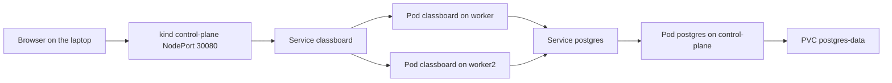

# Architecture

Local track. One laptop, one kind cluster, three nodes.

The browser talks to port 30080 on the host. kind maps that port to the control-plane node. The NodePort Service sends the request to one of the two Classboard pods. Those pods are spread across the two workers. Both pods talk to Postgres through its Service. Postgres is pinned to the control-plane node, with a toleration for that node's taint, so draining a worker does not take the database with it. The PVC is where the rows survive a Postgres restart. It does not survive deleting the cluster.

Configuration that is not secret is in the ConfigMap `classboard-config` (port, version, log level, database host). The database password is in the Secret `classboard-db`, created by Terraform from `TF_VAR_db_password`.

State lives in Postgres, in the `announcements` table. The Classboard pods store nothing on disk. A new pod is ready when `/ready` can run `SELECT 1`.

A drawing of the same layout is in [architecture.svg](architecture.svg).
